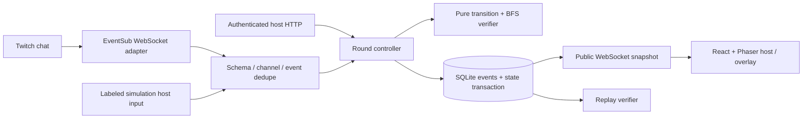

# WORLD//PATCH — deterministic architecture

## Decision record

Single TypeScript workspace. React owns UI and accessibility; Phaser renders the board without owning rules. Fastify owns authorization, rounds and live Twitch. WebSocket carries public snapshots; controller actions use authenticated HTTP POST. SQLite stores checkpoints and an ordered hash-linked event log in one transaction before broadcast. One persistent server/volume, one channel, one active session. Node 22.12 is the dependency minimum; local verification uses 26.12 and the Linux image pins 26.13. Pinned dependencies and lockfile must be installed/tested. No hosted database or inference service.

Independent preflight reviews live in evidence. Key decisions: freeze snapshot through elections; four portal endpoints; explicit incomplete search outcome; no hidden witness in public payload; cold Twitch disconnect voids active elections. Runtime interfaces below are normative; implementation may refine with a documented reason and tests.

## Trust and data flow

## Pure game model

`Direction = up | right | down | left`. Chamber immutable definition: id, version, width, height, tiles, start, exit, key, portals 0..3, wall groups A/B. Tile map contains walls, floor, ice, designated wall groups and portal endpoints. Grid ≤15×15. `Rules = {gravity: Direction | off, portals: normal | crossed, ice: boolean, walls: {A: boolean, B: boolean}}`; wall boolean means closed. `GameState = {chamberId, x, y, hasKey, rules, escaped}`. Engine version is recorded in every replay. No clock, RNG, I/O, animation or mutation in transitions. Solver orchestration accepts an injectable timer solely for its incomplete-search deadline; time never changes game physics.

`transition(chamber, state, direction)` is the only player/solver/replay movement function. Manual step blocked → unchanged state, no gravity. Legal manual step → collect key/check exit; if on an enabled ice tile, continue in the input direction until non-ice or obstruction, checking key/exit along the way. After movement resolves, entering a portal transports once to its partner (arrival does not immediately re-trigger); collect/check exit. Then apply at most one gravity step, if legal, with key/exit and one portal transport on entry but no second ice run. Exit succeeds as soon as entered with key, halting remaining movement. Entering exit without key is ordinary floor. Gravity is explicitly a one-cell drift after a legal move, not continuous acceleration. This preserves readable discrete physics and a small finite state space. Patches change laws without automatically moving the player. A closed wall under the player is invalid.

If implementation combines landing stages differently, update this section before writing tests; the same function remains mandatory. No solver-only shortcuts. A checkpoint is captured on initial load and each accepted patch; reset restores its entire game state. Solvability is guaranteed at that checkpoint, not after every potentially trapping player move; reset is always available during play.

## Patch contract

Discriminated union: `{kind:'gravity',value:Direction|'off'}`; `{kind:'portals',value:'normal'|'crossed'}`; `{kind:'ice',value:boolean}`; `{kind:'walls',group:'A'|'B',closed:boolean}`. Strict command parser anchors whole command, caps length 200 and rejects extra tokens. Canonical key is a stable ASCII string. Server validates all host and provider input with schemas, including directions, action discriminators, IDs and lengths. Only this allowlist can mutate laws. No eval, Function, shell execution, generated code or freeform rule interpreter.

## Verification algorithm and receipt

Clone frozen state, apply patch, reject no-op/occupied wall/escaped state. BFS explores `(x,y,hasKey,escaped)` under the fixed chamber/rules using deterministic action order up,right,down,left. Maximum state count is at most 2WH+1. Track visited before queueing, store parent/action, terminate on escape. The engine defaults to a 5000-node cap and 50ms deadline; the live room explicitly passes ROOM_LIMITS.solverMs = 250 for baseline, proposal and merge verification. These are defensive bounds; exceeding either yields `incomplete`. The explicit room budget repairs a real recorded merge timeout under capture load without accepting unknown results. Exhausting frontier gives `unsolvable`; finding an escape gives `solved` with a witness. Replay the witness through transition before acceptance. These bounds are checked even in tests with forced tiny budgets.

Receipt binds engine/chamber version, exact before snapshot, canonical patch, resulting checkpoint, revision, origin, BFS status/explored count, witness actions and a cryptographic SHA-256 digest of canonical serialized evidence. Runtime digest is integrity/determinism evidence, not a signature or protection from server-operator forgery. Only solved candidates are votable. Before merge, compare expected revision and reverify selected patch. Store new checkpoint, witness and receipt atomically. Public receipt hides witness and snapshot path until reveal; public board state itself is not secret.

## Round state machine

`play → proposing → voting → play → revealed`. `paused` retains phase and remaining duration. `startRound` freezes current game, increments round, clears candidates/ballots. Proposal 25s, vote 20s defaults. Host may close early, pause/resume, cancel, remove candidates, block a participant, reset checkpoint, reveal or select next chamber under explicit guards. One proposal/user/round, 8 candidates; canonical duplicate proposal maps to the same candidate. One vote/user, latest vote replaces old; no automatic self-vote. One shared 2s command cooldown; ignored/invalid traffic does not grow unbounded state. Ties: votes descending then canonical patch key ascending using code-point comparison. Zero votes → no merge. No candidates → return to play. Server time governs windows; command processing first advances expired phases, so late votes cannot race a timer. Auto-close is driven by server ticks.

Live source unavailable → cancel in-flight election and preserve checkpoint/game. Do not accept simulated input in a Twitch session. Simulated input is authenticated, visibly labeled, and receives a separate actor namespace. Single-account live testing permits broadcaster's own real chat messages; no self-message filter.

## Twitch transport and identity

Authorization-code flow with server-held client secret, short-lived random state bound to the host browser, exact configured redirect URI, Secure/HttpOnly/SameSite=Lax cookies under HTTPS, and one-time state consumption. Required scope `user:read:chat`; no write-chat or moderator scope. Validate token via Twitch validate endpoint, verify client_id, user_id and granted scopes. For one-account mode, broadcaster ID and reader ID both equal validated token user ID. Refresh server-side with single-flight protection; validate on acquisition and hourly; revoke/invalid → disconnect and require reauthorization. Secrets stay in memory/environment, never game events/URLs/browser storage; restart requires sign-in because tokens are memory-only, an intentional simplicity/privacy tradeoff.

Connect `wss://eventsub.wss.twitch.tv/ws`; on welcome immediately POST Helix subscription `channel.chat.message` v1 using User Access Token and WebSocket session_id. “Ready” only after successful subscription response. Watch keepalive deadline; parse bounded JSON/schema; match subscription type, channel, session, event time and provider IDs. Dedupe both EventSub message ID and chat message ID. On requested reconnect, allow only Twitch's wss host, connect supplied URL before closing old socket, retain migrated subscription. On unexpected loss, back off with bounded exponential jitter, open fresh socket and recreate subscription; missed events cannot be recovered, so mark gap and cancel election. Stop/revocation cancels retries. Network requests have timeout and bounded 429/5xx retries. Never POST to a chat-supplied URL.

Provider event/message IDs are opaque strings: preserve their exact contents, including punctuation, in separate dedupe namespaces. Adapter and room share `MAX_PROVIDER_ID_LENGTH = 256`, a defensive application bound rather than a Twitch format guarantee. Empty, oversized and non-string values fail closed; internal actor/session IDs retain their stricter validation. IDs are JSON values and bound SQL parameters, never paths, headers, selectors or executable content. The first real round exposed an incorrect ASCII identifier restriction; the repaired boundary is covered by 129/256/257-character tests and an adapter→room→merge→replay regression. Twitch documents notification IDs as strings without a UUID/ASCII-only contract: [WebSocket message reference](https://dev.twitch.tv/docs/eventsub/websocket-reference/), checked 30 October 2026.

## Persistence and replay

SQLite WAL, schema version, append sequence, prior event hash, event payload, event hash, session checkpoint/state and timestamps. Atomic save prevents broadcast of an uncommitted merge. Store accepted game actions and round decisions plus origin/evidence metadata, not arbitrary chat content or raw user IDs; pseudonymize participant identifiers on ingestion with server-only salt. Persist dedupe within retained session history. On startup validate log/state, restore last committed state, cancel active election; corruption fails closed. Replay starts with a versioned chamber snapshot, applies ordered authoritative events using the pure engine, checks expected state hashes and each merge witness. Event export includes what the host explicitly reveals; spectator does not get private actor data. Document retention/pruning and bounded storage in README; no claim of tamper resistance against an administrator.

Ordinary commits are refused with `CAPACITY` (409) once the current revision reaches 19,997, before state mutation, persistence or broadcast. The unchanged 20,000-event storage cap retains three slots for `voting-open`, `merge`, `cancel`, `recovered` and `reveal` events. This allows a pending election to terminate, a restart recovery record and a final Reveal/export. New sessions have independent event counts. The boundary regression uses a valid hash-linked pause/resume prefix at the real cap, then actual close/restart/reveal/export and atomic-failure paths. This is prevention, not repair of already saturated legacy logs.

## Client synchronization and witness inspection

The client accepts runtime-validated read-only WebSocket snapshots and discards older revisions within the same session. Once a valid stream snapshot has arrived, a delayed initial HTTP bootstrap cannot replace it with a prior session. The bootstrap regression holds the HTTP response while a different chamber arrives over the actual local socket. Pending mutation responses also defer to validated stream snapshots received during the request, so an old response cannot restore an archived session. Configuration requests use generations: a delayed bootstrap or earlier refresh cannot undo a newer host login/logout. Server authorization remains authoritative for every mutation.

Replay frames derive from the stored witness through the shared transition function. The timeline index, seek/play state and speed belong to each browser view and never submit a room mutation. Seeking is immediate; sequential play/step can animate validated frames. Reduced motion stops autoplay and uses manual inspection. Public payloads still withhold the witness until Reveal.

## Authorization and limits

One host secret configured in environment; enter through login body, establish expiring HttpOnly host session. Constant-time comparison; login rate limit; strict same-origin checks for mutations and browser WebSocket upgrades; read-only WebSocket never accepts control messages. Local development binds loopback by default. Production must configure exact HTTPS public origin, host secret and persistent directory. No permissive CORS. CSP and security headers; avoid logging OAuth URLs, cookies, bodies or token errors. Requests ≤16KiB; provider frames bounded; connections capped; visible votes/candidates capped; action cooldown/rate limits; no arbitrary files or room IDs.

## Sources checked 28 October 2026

- https://dev.twitch.tv/docs/chat/authenticating/ (installed chatbot, one user token)
- https://dev.twitch.tv/docs/eventsub/handling-websocket-events/ (welcome, reconnect, loss)
- https://dev.twitch.tv/docs/eventsub/eventsub-subscription-types/#channelchatmessage
- https://dev.twitch.tv/docs/authentication/getting-tokens-oauth/#authorization-code-grant-flow
- https://dev.twitch.tv/docs/authentication/validate-tokens/
- https://dev.twitch.tv/docs/authentication/refresh-tokens/

Actual OAuth and same-account proposal/rejection/vote/merge/escape/replay were verified on 30 October 2026; see evidence/twitch-live-validation.json. Controlled actual cold reconnect was also observed after a 35-second local process stall: keepalive timeout, re-subscription readiness and preserved state. This does not verify a provider outage, requested migration or live active-election cancellation. A corrected Nov2 actual Twitch round and 1080p30 OBS game/chat capture also passed, with independent replay reconstruction and complete digital-silence audio inspection. The combined96-second Twitch/Codex edit passed scoped local metadata/cadence and selected-frame review; the unlisted video and repository are published, with anonymous metadata readbacks verified. Complete public privacy-domain video playback and full hosted acceptance subsequently passed. A fresh isolated browser profile was not verified; strict anonymous playback is not claimed. Fixture lifecycle tests do not satisfy live/video gates.

## Release-evidence boundary — 2 November 2026

The pre-recording 46-file runtime/test/configuration fingerprint passed 113 checks and 22 browser journeys. The subsequent bounded room-budget repair passed its own fresh 114-check and 22-browser gate; unchanged source and proof scopes remain recorded separately. A staged release checkout excludes private environment files, databases, dependencies/build caches, work directories, raw recordings and logs. Repository staging and secret scanning are preparation; they neither create public access nor authorize a commit/push. The main session remains the preserved Codex build identity. Generated narration is an optional production artifact outside the game runtime and must use Deepgram exclusively if commissioned; no runtime model or generated voice is required to run WORLD//PATCH.

## Required full hosting

The release must run the complete application on one persistent server: Fastify serves the normal React/Phaser build, host/API routes and read-only browser WebSocket stream; the same process maintains outbound Twitch OAuth/EventSub state and SQLite. The user requires this full hosted journey. GitHub Pages can serve the separately labeled browser-only sandbox, but cannot provide the room, OAuth callbacks, EventSub adapter, WSS broadcast or durable SQLite.

The selected deployment reuses the existing Foley Lightsail host at `https://worldpatch.13.204.212.172.sslip.io`. A manual GitHub workflow builds and tests the Linux/amd64 image off-host, then produces a checksum-bound artifact for manual import. No production credentials or remote deployment action belongs in that workflow. The existing host does not compile the application. Runtime limits are 512 MiB RAM and 0.5 CPU, with one Node process, a dedicated Docker network, no published host port and one writable `/data` volume. Caddy proxies only the new hostname while preserving its existing sites and networks.

`TRUSTED_PROXY_IP` is optional and accepts one exact IPv4 or IPv6 address. Unset preserves `trustProxy:false`; invalid addresses, CIDRs and blanket boolean trust fail startup. Production sets only Caddy’s address on the dedicated application network. Fastify can then derive the client address through that trusted hop without trusting arbitrary forwarded chains. This supports per-client rate limiting behind Caddy; exact browser Origin validation remains independent. Recheck the address when Caddy is recreated.

Public origin precedence remains explicit PUBLIC_ORIGIN, RENDER_EXTERNAL_URL for the unused Render-compatible path, then the loopback default. Lightsail sets PUBLIC_ORIGIN explicitly to the HTTPS hostname and registers its exact `/auth/twitch/callback`. An explicit TWITCH_REDIRECT_URI still takes precedence. Keep VITE_STATIC_DEMO unset.

The local gate passed 127 tests, typecheck/lint/build on Node 26.12.0 macOS. CI3 then passed 39 actual Node 26.13.0 Linux/amd64 container checks, including native SQLite, runtime isolation, restart and replay. The checksum-bound image was deployed on the existing host. The actual public service passed 78 HTTPS/WSS/security/simulation/recovery checks and a separately verified real hosted Twitch round. A 38-event Twitch replay reconstructed the merged wall law and escaped final game. Root’s aggregate binds source commit 49555058b0e9ceb99060ce9dc3202d1ea4bd255c, artifact/layers, runtime limits and coexistence evidence in `evidence/lightsail-deployment.json`.

Actual Caddy forwarding-spoof tests held the login bucket despite forged forwarded addresses, while a different actual source could authenticate within that window. The six existing containers retained identity/start/restart counts and five HTTPS routes remained200 before/after. Resource observations are snapshots, not audience-scale or uptime guarantees. No hosted provider outage/reconnect was exercised. OAuth/host sessions remain memory-only after application restart even though game/events persist.
